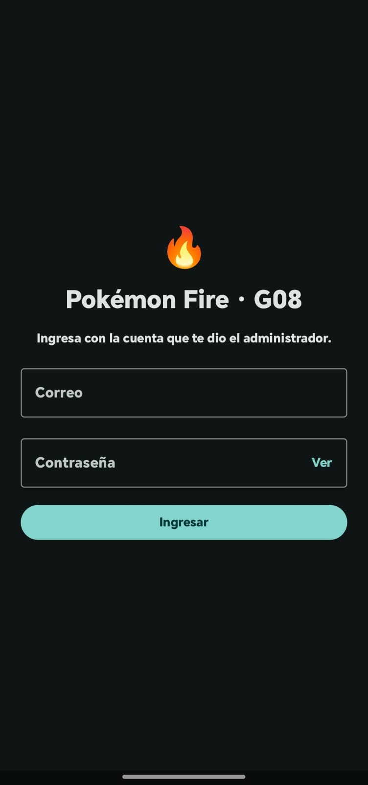
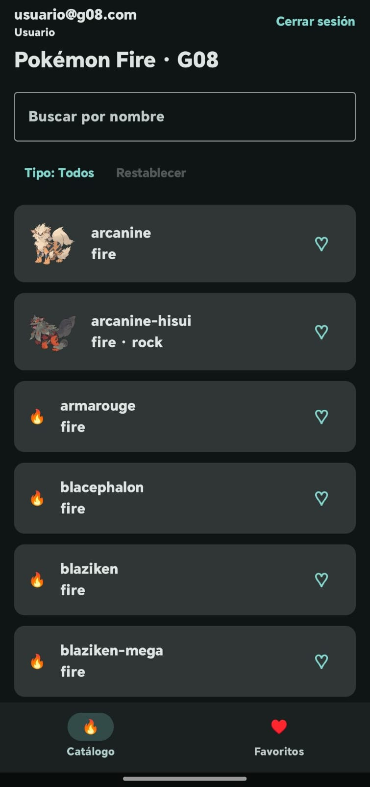
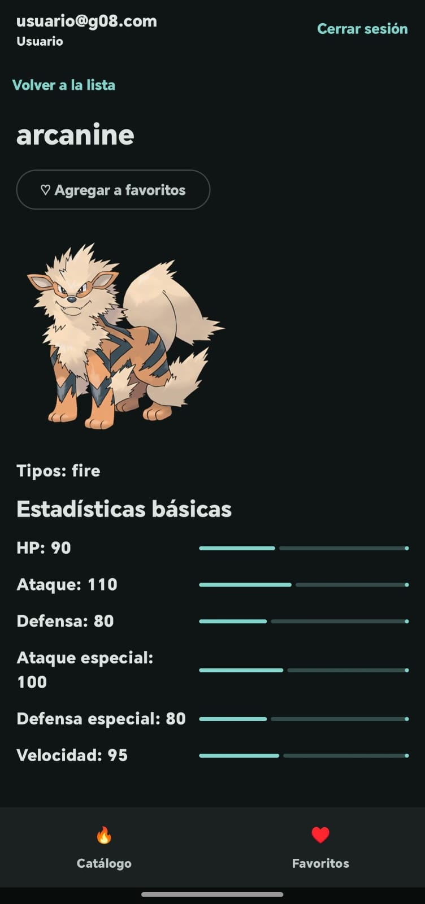
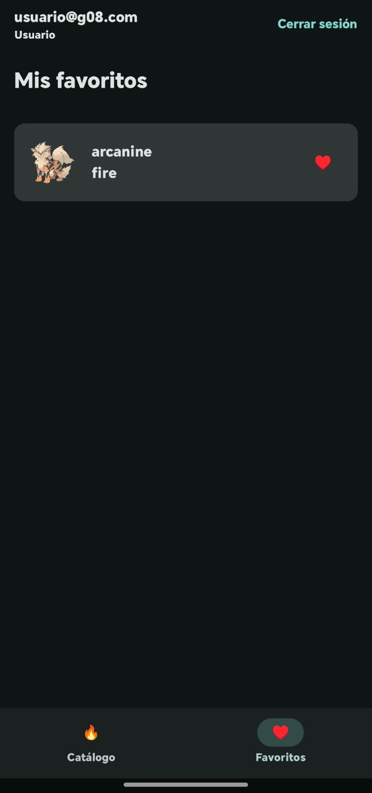
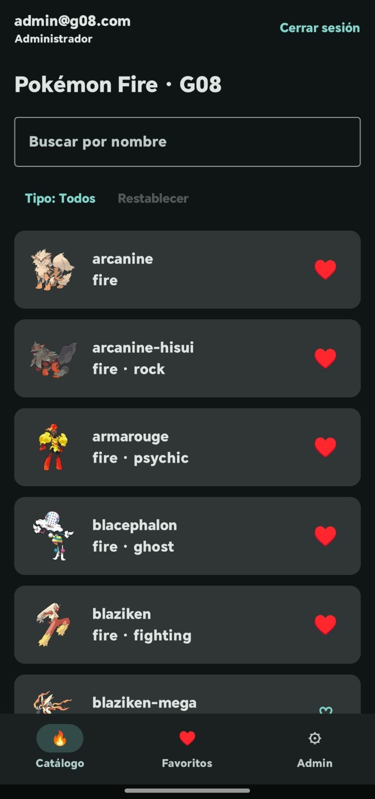
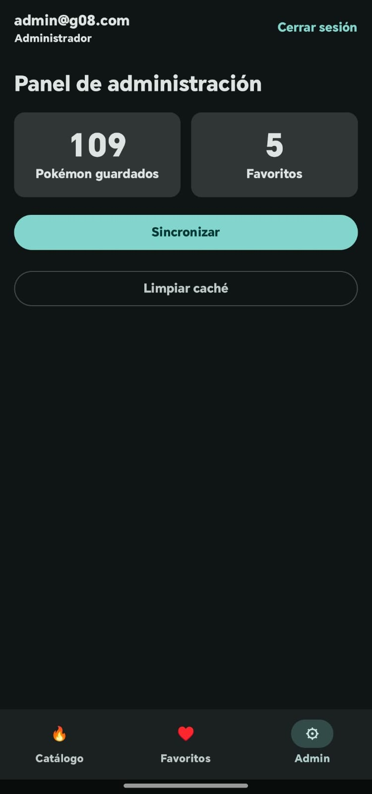
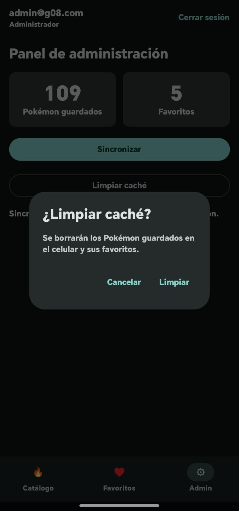
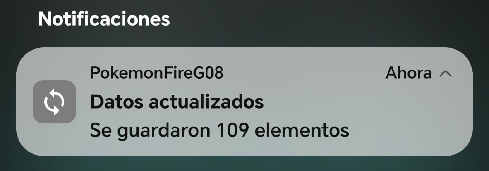
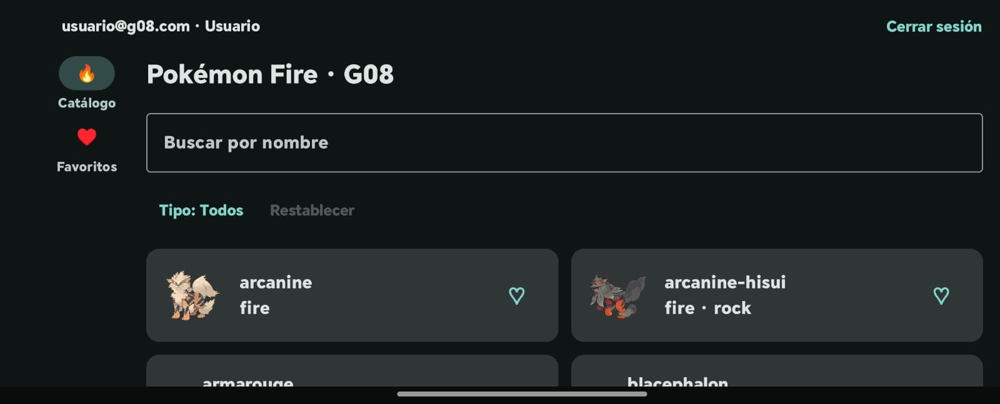

# lab-integrador-G08-Espiritu-Alburqueque
Laboratorio 11-12 - Aplicación Android Pokémon con Kotlin, Compose, MVVM, Retrofit, Room y Firebase.

- **Grupo:** G08
- **Tema:** Pokémon (PokeAPI)
- **Variante:** tipo `fire` — lista con `/type/fire` y detalle con `/pokemon/{nombre}`
- **Paquete:** `com.tecsup.pokemon` (proyecto en la carpeta `PokemonFireG08/`)

## Funcionalidades

| Zona | Qué hace |
|---|---|
| Login | Correo y contraseña con Firebase Authentication. Valida campos vacíos y formato del correo sin llamar a Firebase. |
| Roles | El rol se lee de Firestore en `usuarios/{uid}` (campo `rol`). La app no lo decide. |
| Sesión | Se mantiene al reabrir la app. Botón **Cerrar sesión** en la barra superior. |
| Catálogo | Lista desde Room (fuente de verdad) actualizada por Retrofit, con búsqueda, filtros, estados Cargando / Error / Vacío y modo sin conexión. |
| Detalle | Segundo endpoint de PokeAPI con tipos y estadísticas. |
| Favoritos | Se marcan con ♡ en la lista o en el detalle. Pestaña Favoritos. Sobreviven al cerrar la app y al sincronizar. |
| Panel Admin | Solo rol `admin`: total guardado, total de favoritos, **Sincronizar** y **Limpiar caché**. |
| Notificación | Al terminar de sincronizar: «Se guardaron N elementos». Canal propio, permiso `POST_NOTIFICATIONS` y al tocarla se abre la app. |

## Cómo compilar

1. Clonar el repositorio y abrir la carpeta `PokemonFireG08` en Android Studio.
2. Colocar `google-services.json` dentro de `PokemonFireG08/app/` (ver siguiente sección). **No se sube al repositorio.**
3. Sync de Gradle y ejecutar en un emulador **con Google Play**.

Pruebas unitarias:

```powershell
.\gradlew.bat :app:testDebugUnitTest
```

## Configurar Firebase

1. En [console.firebase.google.com](https://console.firebase.google.com/) crear un proyecto (Analytics opcional).
2. Registrar la app Android con el paquete exacto `com.tecsup.pokemon`.
3. Descargar `google-services.json` y copiarlo en `PokemonFireG08/app/`.
4. **Authentication → Método de acceso:** activar *Correo electrónico/contraseña*.
5. **Authentication → Usuarios:** crear dos usuarios de prueba, por ejemplo `admin@g08.com` y `usuario@g08.com`.
6. **Firestore Database:** crear la base de datos y la colección `usuarios` con un documento por usuario.
   - ID del documento = **UID** del usuario (copiarlo desde Authentication → Usuarios).
   - Campos: `rol` (texto: `admin` o `usuario`) y `nombre` (texto).
7. **Firestore → Reglas:** pegar y publicar:

```
rules_version = '2';
service cloud.firestore {
  match /databases/{database}/documents {
    match /usuarios/{uid} {
      allow read: if request.auth != null && request.auth.uid == uid;
      allow write: if false;
    }
  }
}
```

> Si el rol siempre sale "Usuario", revisa que el ID del documento sea exactamente el UID.

## Capturas

| Login | Catálogo (usuario) | Detalle |
|:---:|:---:|:---:|
|  |  |  |

| Favoritos | Catálogo (admin) con favoritos | Panel Admin |
|:---:|:---:|:---:|
|  |  |  |

| Limpiar caché (confirmación) | Notificación al sincronizar |
|:---:|:---:|
|  |  |

**Fase 2 · Vista horizontal** (menú lateral y lista en dos columnas):



## Reparto de tareas

| Funcionalidad | Responsable |
|---|---|
| Proyecto base, estructura MVVM y contratos | Sebastián Espíritu |
| Retrofit, lista, detalle, búsqueda y filtros | Sebastián Espíritu |
| Room, modo sin conexión y pruebas de repositorio | Sebastián Espíritu |
| Firebase Authentication y login | Kiara Alburqueque |
| Roles ADMIN y USUARIO desde Firestore | Kiara Alburqueque |
| Mantener y cerrar sesión | Kiara Alburqueque |
| Pantalla de favoritos | Kiara Alburqueque |
| Panel de administración | Kiara Alburqueque |
| Notificaciones locales | Kiara Alburqueque |
| Pruebas de login, sesión, favoritos, admin y notificación | Kiara Alburqueque |
| Integración final, README y fase mejora-ia | Ambos |
